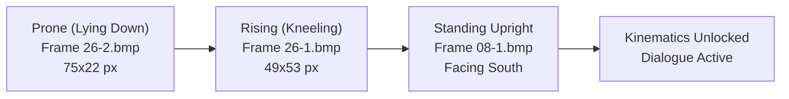
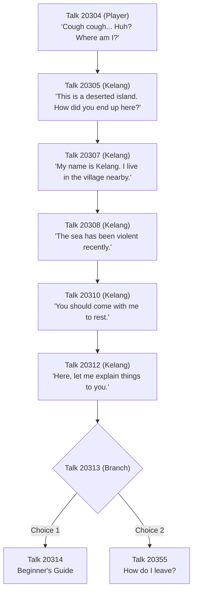

# Beach Awakening (Map 10011) Specification

## 1. Overview & Ground Truth
This specification details the architecture, node hierarchy, character paperdoll composite animation frames, NPC placement, authentic dialogue sequencing, and environmental effects for **Map 10011 (Deserted Island Beach)**, verified against video seconds 241 to 320 in `2026-10-22 21-17-03.mp4`.

- **Scene Path**: [`scenes/maps/map_10011_beach.tscn`](file:///D:/Godot/WonderlandOnline/wonderland-online-client/scenes/maps/map_10011_beach.tscn)
- **Controller Path**: [`scripts/events/beach_awakening.gd`](file:///D:/Godot/WonderlandOnline/wonderland-online-client/scripts/events/beach_awakening.gd)
- **Automated Verification**: [`tests/test_event_sequences.gd`](file:///D:/Godot/WonderlandOnline/wonderland-online-client/tests/test_event_sequences.gd)

---

## 2. Map Assets & Coordinates

| Component | Asset Identifier | Dimensions | Purpose |
|---|---|---|---|
| Map Artwork | `10003.jpg` (in `map.JMG`) | `4672 x 5056` | Authoritative background graphic for South Island shoreline (Map 10011) |
| Radar Minimap | `menu/Skins/default/t10011.bmp` | `222 x 959` | Authentic radar minimap graphic decoded by `ArchiveLoader` |
| Player Spawn | In-World Coordinate | `Vector2(1040, 2220)` | Shoreline landing coordinates washed ashore |
| Kelang Spawn | In-World Coordinate | `Vector2(1120, 2160)` | Shoreline coordinates standing north-east of player |

---

## 3. Prone-to-Standing Character Awakening Animation

Authentic Wonderland Online character sprites encode lying down and getting up within character JMP archives (`002.jma`, `003.jma`, etc.):

### Composite Frame Decoding & Paperdoll Blending
- **Prone Frame (`26-2.bmp`)**: Body lies horizontal on the tropical sand. All equipped paperdoll layers (hair `*h`, clothing `*e`, shoes `*s`) composite matching `26-2.bmp` frames.
- **Rising Frame (`26-1.bmp`)**: Character transitions to a crouching/kneeling posture.
- **Stand Frame (`08-1.bmp`)**: Upright idle stance facing South.
- **Kinematic Guard**:
  - `player.is_movement_locked = true`
  - `player.is_prone = true`
  - User click-to-move and keyboard inputs are rejected while `is_movement_locked` is active.
  - Movement unlocks upon completion of dialogue or programmatic `unlock_player_movement()`.

---

## 4. Kelang NPC & Dialogue Tree

### Identity & Placement
- **NPC ID**: `14062` ("Kelan Leader")
- **Model Archive**: `1131.jmp` (78 animation frames)
- **Portrait Archive**: `8038.jmp` in `008.jma`
- **Heading**: `IsometricMath.Heading.SOUTH_WEST` (Facing 5, oriented towards the washed ashore player)

### Authentic Dialogue Sequence (`Talk.dat`)

---

## 5. Environmental Waves & Audio Effects

- **Wave Effects (`WaveEffects`)**:
  - Modulated rhythmically in `_process(delta)`:
    `alpha = (sin(_wave_timer * 1.5) + 1.0) * 0.2 + 0.3`
  - Simulates dynamic water tides washing onto the shoreline sand.
- **Ambient Audio (`AmbientWavesAudio`)**:
  - Asset: `res://assets/sound/wav9917.wav` (authentic looping sea wave wash).
  - Stream mode: Autoplay, looping enabled.
- **Beach BGM (`BeachBGM`)**:
  - Environmental music channel playing tropical island soundtrack.

---

## 6. Script API Reference (`BeachAwakening`)

### Methods

- `start_awakening_sequence() -> void`:
  Initializes player in prone position at `Vector2(1040, 2220)`, locks player movement, fades in from black over 2.5 seconds, dispatches `play_wakeup_animation()`, and triggers Kelang dialogue.
- `on_player_wakeup_completed() -> void`:
  Signal handler called when prone-to-standing animation completes. Triggers Kelang interaction.
- `trigger_kelang_dialogue() -> void`:
  Initiates Talk ID `20304` -> `20305` dialogue sequence via `DialogueManager` or HUD.
- `unlock_player() -> void`:
  Clears `is_movement_locked` and `is_prone`, restores normal click-to-move pathfinding.

### Signals

- `awakening_started()`
- `player_stood_up()`
- `kelang_dialogue_finished()`
- `awakening_completed()`

---

## 7. Automated Verification

Tested via `C:\Godot\godot_console.exe --headless --path D:\Godot\WonderlandOnline\wonderland-online-client -s tests/test_event_sequences.gd`:
- **Part 4**: Map 10011 scene structure, background graphic (`10003.jpg`), and minimap (`t10011.bmp`) verified.
- **Part 5**: Prone (`26-2.bmp`), rising (`26-1.bmp`), and standing (`08-1.bmp`) composite frames and kinematic lock verified.
- **Part 6**: Kelang NPC ID (`14062`), model (`1131.jmp`), South-West heading, and Talk 20304..20314 dialogue tree verified.
- **Part 7**: Shoreline wave oscillation and ambient audio streams verified.
