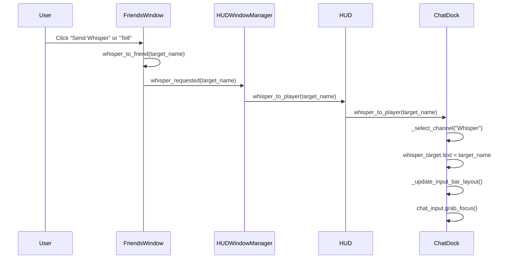

# Wonderland Online Friends Window & Direct Whisper Chat Specification

## Executive Summary
This document specifies the technical architecture, visual layout, authentic asset slicing, and functional behavior of the **Friends Window** (`Form_Friend_2`, 356x493) and its integration with the **HUD Chat Dock** whisper system (`hud_chat.gd`) in the Wonderland Online Godot 4 client.

All graphical elements are constructed exclusively from authentic Wonderland Online skin bitmaps from `D:/GitHub/wlridecode/menu/Skins/` (specifically `Form_Friend_2.bmp`, `Bmp_Friend_1.bmp`, `Btn_AddNew_1.bmp`, `btn_delFriend_1.bmp`, `Btn_FriendIcon_1.bmp`, `Form_Talk_3.bmp`, `btn_ok_1.bmp`, `Btn_Cancel_1.bmp`) with zero generic flat panels, zero green chroma-key bleed, and full 2000s classic MMORPG typography.

---

## 1. Asset Pipeline & Geometry

### 1.1 Skin Bitmaps & Slicing
All assets were converted from original 24-bit/8-bit indexed BMP files using pure green (`RGB(0, 255, 0)`) chroma key transparency followed by 2-pixel anti-aliased edge defringing:

| Asset Name | Source BMP | Godot Destination | Dimensions | Description |
|---|---|---|---|---|
| `form_friend_2.png` | `menu/Skins/white/Form_Friend_2.bmp` | `res://assets/hud/form_friend_2.png` | 356x493 | Main window parchment background with pre-rendered embossed slot frames |
| `bmp_friend_title.png` | `menu/Skins/default/Bmp_Friend_1.bmp` | `res://assets/hud/bmp_friend_title.png` | 41x15 | Authentic window header title graphic badge |
| `btn_add_new_1_*.png` | `menu/Skins/default/Btn_AddNew_1.bmp` | `res://assets/hud/btn_add_new_1_[normal/hover/pressed].png` | 56x20 | 3-state "+ Add Friend" action button |
| `btn_del_friend_1_*.png` | `menu/Skins/default/btn_delFriend_1.bmp` | `res://assets/hud/btn_del_friend_1_[normal/hover/pressed].png` | 61x20 | 3-state "- Delete Friend" action button |
| `btn_friend_icon_1_*.png` | `menu/Skins/default/Btn_FriendIcon_1.bmp` | `res://assets/hud/btn_friend_icon_1_[normal/hover/pressed].png` | 66x21 | 3-state "Send Whisper" action button & row tell badge |
| `form_talk_3.png` | `menu/Skins/white/Form_Talk_3.bmp` | `res://assets/hud/form_talk_3.png` | 324x168 | Authentic modal dialog frame for Add and Delete confirmation |
| `btn_ok_1_*.png` | `menu/Skins/default/btn_ok_1.bmp` | `res://assets/hud/btn_ok_1_[normal/hover/pressed].png` | 56x20 | Modal dialog confirm button |
| `btn_cancel_1_*.png` | `menu/Skins/default/Btn_Cancel_1.bmp` | `res://assets/hud/btn_cancel_1_[normal/hover/pressed].png` | 56x20 | Modal dialog cancel button |
| `friend_slot_bg.png` | `Form_Friend_2.bmp` slot slice | `res://assets/hud/friend_slot_bg.png` | 328x61 | Authentic card slot background texture |
| `friend_slot_bg_selected.png` | `Form_Friend_2.bmp` slot slice | `res://assets/hud/friend_slot_bg_selected.png` | 328x61 | Card slot background with 2px radiant gold highlight |

### 1.2 Window Coordinates & Controls Layout

```
(0, 0) +-----------------------------------------------------------+ (356, 0)
       | [TitleBadge 41x15] Friends [F]             [CloseBtn 18x18]|
       | Friends: 5 / 50  (Online: 3)                              |
       +-----------------------------------------------------------+ (Y=66)
       | ScrollContainer (328 x 380)                               |
       |  +-----------------------------------------------------+  |
       |  | [O] [Elem] Betty (Lv. 18)   Welling Village   [Tell]|  | (Slot 0)
       |  +-----------------------------------------------------+  |
       |  | [O] [Elem] Daniel (Lv. 24)  South Island      [Tell]|  | (Slot 1)
       |  +-----------------------------------------------------+  |
       |  | [X] [Elem] Kelang (Lv. 30)  Kranor Village    [Tell]|  | (Slot 2)
       |  +-----------------------------------------------------+  |
       +-----------------------------------------------------------+ (Y=448)
       | [BtnAdd 56x20]   [BtnDel 61x20]        [BtnWhisper 66x21] | (Y=455)
(0,493)+-----------------------------------------------------------+ (356, 493)
```

- **Window Bounds:** `Vector2(356.0, 493.0)` (`custom_minimum_size = Vector2(356, 493)`).
- **Close Button:** `Vector2(326.0, 8.0)` (`size = Vector2(18, 18)`).
- **Scroll Area:** `Vector2(14.0, 66.0)`, `size = Vector2(328.0, 380.0)`.
- **Card Size:** `Vector2(324.0, 58.0)` matching the pre-drawn Delphi skin slot dimensions.

---

## 2. Friends Window Controller (`FriendsWindow`)

### 2.1 Properties & Data Model

```gdscript
const WINDOW_WIDTH: float = 356.0
const WINDOW_HEIGHT: float = 493.0
const MAX_FRIENDS: int = 50
const FRIENDS_FILE_PATH: String = "user://friends_list.json"
```

Each friend entry is structured as:
```gdscript
{
    "name": String,          # Character name (unique, case-insensitive)
    "level": int,            # Character level (clamped 1..200)
    "element": String,       # Elemental affinity ("Earth", "Water", "Fire", "Wind")
    "online": bool,          # Online status indicator (green = true, gray = false)
    "location": String       # Current map / zone name
}
```

### 2.2 Signals

- `signal friend_selected(friend_data: Dictionary)`: Emitted when an entry is clicked.
- `signal friend_added(friend_data: Dictionary)`: Emitted when a valid new friend is created.
- `signal friend_deleted(friend_name: String)`: Emitted when a friend is removed.
- `signal whisper_requested(target_name: String)`: Emitted when whisper action is triggered.
- `signal window_closed`: Emitted when the window is dismissed via close button or Escape key.

### 2.3 Public API Methods

| Method | Parameters | Return Type | Description |
|---|---|---|---|
| `setup(hud: Control = null)` | `hud: Control` | `void` | Initializes references, builds UI if needed, loads friends list. |
| `open_window()` | None | `void` | Displays window, moves to front, refreshes list cards. |
| `close_window()` | None | `void` | Hides window, plays UI click audio, emits `window_closed`. |
| `toggle_window()` | None | `void` | Toggles window visibility between open and closed. |
| `add_friend(p_name, p_level, p_element, p_online, p_location)` | `p_name: String`, `p_level: int = 1`, `p_element: Variant = "Earth"`, `p_online: bool = true`, `p_location: String = "Welling Village"` | `bool` | Validates non-empty name, verifies no duplicate exists, appends friend, saves to JSON, refreshes list. Returns `true` on success. |
| `delete_friend(name_or_index: Variant)` | `name_or_index: Variant` (String name or int index) | `bool` | Removes friend at index or matching name, shifts selection, saves to JSON, refreshes list. Returns `true` on success. |
| `select_friend(idx: int)` | `idx: int` | `void` | Updates `_selected_friend_index`, updates card highlight textures, plays click audio, emits `friend_selected`. |
| `get_selected_friend()` | None | `Dictionary` | Returns duplicate of currently selected friend data or empty dictionary. |
| `get_friends()` | None | `Array[Dictionary]` | Returns deep copy of the complete friends array. |
| `set_friends(friends: Array)` | `friends: Array` | `void` | Replaces current list with provided array, saves, and re-renders. |
| `send_whisper_to_selected()` | None | `void` | Triggers whisper routing for the currently selected friend. |
| `whisper_to_friend(target_name: String)` | `target_name: String` | `void` | Directs whisper to `target_name` via ChatDock / HUD controller. |
| `save_friends_list()` | None | `bool` | Serializes `_friends` array to formatted JSON in `user://friends_list.json`. |
| `load_friends_list()` | None | `Array[Dictionary]` | Loads and deserializes `user://friends_list.json`. Populates defaults if missing. |
| `refresh_list_view()` | None | `void` | Rebuilds card nodes inside `list_container`, updates summary count label. |

---

## 3. Direct Whisper Integration Architecture

When a player clicks `"Send Whisper"` (`BtnWhisper`) or the row `"Tell"` button on any friend card:



1. **Target Selection:** Populates `WhisperTarget` `LineEdit` with the friend's exact character name.
2. **Channel Auto-Switch:** Switches active chat channel to `"Whisper"`.
3. **Layout Auto-Fitting:** `WhisperTarget` becomes visible at `(74, 2)` (size `86x21`) and `ChatInput` shifts from `X=74` to `X=163`.
4. **Input Focus:** Calls `chat_input.grab_focus()`, allowing the player to immediately begin typing their private message.

---

## 4. Modal Dialogs Architecture

Both modal popups utilize the authentic `Form_Talk_3.png` (324x168) frame with a semi-transparent backdrop (`Color(0, 0, 0, 0.45)`) blocking background mouse interactions (`MOUSE_FILTER_STOP`):

1. **`AddFriendModal`:**
   - Frame position: `Vector2(16, 140)`, size `Vector2(324, 168)`.
   - Title: `"Add Friend"` with 2px shadow.
   - Prompt: `"Enter character name to add:"`
   - Input: `LineEdit` (`AddInput`) with gold blinking caret and parchment background.
   - Error label: Displays validation messages in red (e.g., `"Name cannot be empty!"`, `"Player is already in your friends list!"`).
   - Buttons: Authentic `btn_ok_1` (`OK`) and `btn_cancel_1` (`Cancel`) (56x20).
2. **`DeleteFriendModal`:**
   - Prompt: `"Are you sure you want to remove\n'%s' from your friends list?"`
   - Buttons: Authentic `btn_ok_1` (`Delete`) and `btn_cancel_1` (`Cancel`).

---

## 5. Verification & Automated Test Suite

Test suite `tests/test_friends_window_and_whisper.gd` executes headlessly via `C:\Godot\godot_console.exe --headless -s tests/test_friends_window_and_whisper.gd`:

- **Test Suite Results:** **73 passed, 0 failed (100% pass rate)**.
- **Verification Coverage:**
  1. Window dimensions (356x493), background texture, and close button (Vector2(326, 8)).
  2. Friends list rendering (5 default entries, status lights, element badges, levels, locations).
  3. Interactive selection and gold highlight styling.
  4. Add friend validation (duplicate rejection, empty string rejection, modal flow).
  5. Delete friend confirmation and removal.
  6. JSON persistence (`user://friends_list.json` serialization and disk reloading).
  7. Direct whisper routing to `ChatDock` (target population, channel switch, input focus).
  8. `HUDWindowManager` toggle via 'F' key and close button signal flow.
