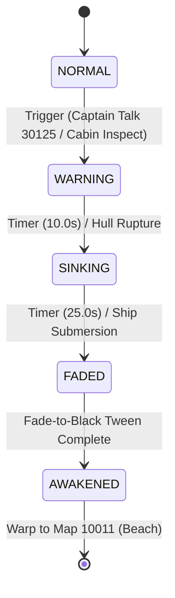

# Ship Sinking Event Sequence Specification

## 1. Overview & Ground Truth
This specification details the architecture, timing, visual trauma kinematics, emergency illumination, audio cues, and state machine transitions for the **Ship Sinking Cutscene Event** (video seconds 176 to 240 in `2026-10-22 21-17-03.mp4`).

- **Scene Path**: [`scenes/events/sinking_cutscene.tscn`](file:///D:/Godot/WonderlandOnline/wonderland-online-client/scenes/events/sinking_cutscene.tscn)
- **Controller Path**: [`scripts/events/sinking_cutscene.gd`](file:///D:/Godot/WonderlandOnline/wonderland-online-client/scripts/events/sinking_cutscene.gd)
- **Automated Verification**: [`tests/test_event_sequences.gd`](file:///D:/Godot/WonderlandOnline/wonderland-online-client/tests/test_event_sequences.gd)

---

## 2. Stage Progression & State Machine

### Stage Details

| Stage | Enum Value | Duration | Video Sec | Trauma | Ship Roll | Red Hazard Overlay | Audio Assets |
|---|---|---|---|---|---|---|---|
| `NORMAL` | `0` | Idle | 0-175 | 0.0 | 0.0° | Alpha 0.0 | Ambient Deck BGM |
| `WARNING` | `1` | 10.0s | 176-186 | 0.25 | ~3.0° | 2.0 Hz Pulse (Alpha 0.0 - 0.4) | `wav9911.wav` (Alarm Siren) |
| `SINKING` | `2` | 25.0s | 186-211 | 0.85 - 1.0 | Up to 18.0° | 4.0 Hz Pulse (Alpha 0.2 - 0.6) | `wav9911.wav` + `wav9915.wav` (Groan) |
| `FADED` | `3` | 3.0s | 211-240 | Decays to 0.0 | Static Tilt | Black Fade Overlay (Alpha 0.0 -> 1.0) | Muffled Wave Submersion |
| `AWAKENED` | `4` | Event Complete | 241+ | 0.0 | 0.0° | Handed to Map 10011 | Fade-in on Map 10011 |

---

## 3. Camera Trauma & Shake Mechanics

The screen tremor is governed by a decaying trauma system using `FastNoiseLite` for organic turbulence:

1. **Trauma Value**: Float in range `[0.0, 1.0]`.
2. **Quadratic Shake Factor**: `shake = trauma * trauma` (provides non-linear, high-impact feel).
3. **Offset Calculation**:
   - `offset_x = max_offset.x * shake * noise.get_noise_2d(noise_x, 0.0)`
   - `offset_y = max_offset.y * shake * noise.get_noise_2d(0.0, noise_y)`
   - `rotation = max_roll * shake * noise.get_noise_2d(noise_x, noise_y)`
4. **Trauma Decay**: `trauma = max(0.0, trauma - decay_rate * delta)` where `decay_rate = 0.5`.
5. **Progressive Ship Tilt**:
   - In `SINKING` stage: `tilt_angle = sin(stage_timer * 0.8) * 0.15 + (stage_progress * 0.16)` radians (up to ~18° listing).

---

## 4. Audio Cue Mappings

| Cue | Asset Path | Behavior | Import Status |
|---|---|---|---|
| Alarm Siren | `res://assets/sound/wav9911.wav` | Looped 2D audio during `WARNING` and `SINKING` | Imported |
| Ship Groan / Sinking | `res://assets/sound/wav9915.wav` | One-shot heavy structural collapse on `SINKING` entry | Imported |
| Ambient Waves | `res://assets/sound/wav9917.wav` | Loop audio playing underlying ocean wash | Imported |

---

## 5. Script API Reference (`SinkingCutscene`)

### Methods

- `start_sinking_sequence() -> void`:
  Transitions stage from `NORMAL` to `WARNING`, triggers camera trauma (0.35), activates red pulsing overlay, and starts siren audio.
- `trigger_sinking_impact() -> void`:
  Transitions stage to `SINKING`, sets trauma to 1.0, plays hull rupture SFX (`wav9915.wav`), and increases emergency flash rate.
- `fade_to_black(duration: float = 3.0) -> void`:
  Tweens `FadeOverlay` modulate alpha from 0.0 to 1.0. Emits `cutscene_faded_out`.
- `compute_ship_tilt(stage: int, elapsed_time: float) -> float`:
  Pure mathematical helper computing ship roll in radians for any given stage and timestamp.
- `add_trauma(amount: float) -> void`:
  Adds trauma clamped to `[0.0, 1.0]`.

### Signals

- `stage_changed(old_stage: int, new_stage: int)`
- `sinking_started()`
- `cutscene_faded_out()`
- `cutscene_completed()`

---

## 6. Automated Verification

Tested via `C:\Godot\godot_console.exe --headless --path D:\Godot\WonderlandOnline\wonderland-online-client -s tests/test_event_sequences.gd`:
- **Part 1**: Sinking cutscene scene structure and node bindings verified.
- **Part 2**: Stage progression (`NORMAL` -> `WARNING` -> `SINKING` -> `FADED` -> `AWAKENED`) and trauma decay verified.
- **Part 3**: Captain dialogue trigger (`Talk 30125`) and cabin inspection triggers verified.
