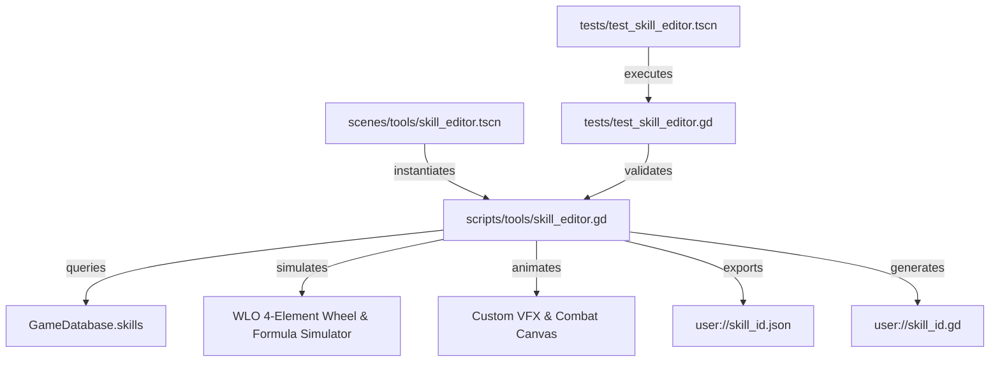

# Technical Specification: Skill & Combat VFX Authoring Studio

## 1. Overview
The **Skill & Combat VFX Authoring Studio** (`scripts/tools/skill_editor.gd`, `scenes/tools/skill_editor.tscn`) is a production-grade visual developer tool designed for the Wonderland Online (WLRI) Godot 4 client.
It provides comprehensive authoring, real-time formula simulation, motion timeline choreography, VFX/SFX binding, JSON serialization, and standalone GDScript code generation.

The tool bridges reverse-engineered data structures from `data/Skill.dat` (953 skills, 148-byte records) and `data/SkillData.MBTM` (1,829 battle motion sequences) with modern Godot 4 rendering, simulation, and pipeline tooling.

---

## 2. Architecture & File Layout

| File Path | Component | Responsibility |
|---|---|---|
| [`scripts/tools/skill_editor.gd`](file:///D:/Godot/WonderlandOnline/wonderland-online-client/scripts/tools/skill_editor.gd) | `SkillEditor` (extends `Control`) | Core logic, state management, element wheel calculations, playback loop, JSON & script export. |
| [`scenes/tools/skill_editor.tscn`](file:///D:/Godot/WonderlandOnline/wonderland-online-client/scenes/tools/skill_editor.tscn) | Tool Scene (800x600 dark theme) | 3-column responsive layout: Identity, Formula Simulator, Motion & VFX Canvas. |
| [`tests/test_skill_editor.gd`](file:///D:/Godot/WonderlandOnline/wonderland-online-client/tests/test_skill_editor.gd) | `TestSkillEditor` (extends `Node`) | Automated headless test suite verifying skill creation, presets, formulas, MBTM, and exports. |
| [`tests/test_skill_editor.tscn`](file:///D:/Godot/WonderlandOnline/wonderland-online-client/tests/test_skill_editor.tscn) | Test Scene | Headless execution harness for `test_skill_editor.gd` via `--scene`. |
| [`tests/test_skill_editor_runner.gd`](file:///D:/Godot/WonderlandOnline/wonderland-online-client/tests/test_skill_editor_runner.gd) | Test Runner (`SceneTree`) | CLI test runner harness for execution via `-s`. |
| [`docs/skill_and_vfx_editor_spec.md`](file:///D:/Godot/WonderlandOnline/wonderland-online-client/docs/skill_and_vfx_editor_spec.md) | Technical Specification | Architecture, formulas, presets, schema, and verification reports. |



---

## 3. Data Enums & Type Definitions

### 3.1 `Element`
```gdscript
enum Element {
	NONE = 0,
	EARTH = 1,
	WATER = 2,
	FIRE = 3,
	WIND = 4
}
```

### 3.2 `SkillType`
```gdscript
enum SkillType {
	PHYSICAL = 0,
	MAGIC = 1,
	ASSIST = 2,
	STATUS = 3,
	SPECIAL = 4
}
```

### 3.3 `TargetScope`
```gdscript
enum TargetScope {
	SINGLE = 0,
	ROW = 1,
	COLUMN = 2,
	CROSS = 3,
	ALL = 4
}
```

---

## 4. Authentic Combat Mechanics & Damage Formula Simulator

### 4.1 Four-Element Wheel Counter Rules
In Wonderland Online, elemental counters govern combat effectiveness:
- **Earth (1)** beats **Water (2)** (+25% bonus)
- **Water (2)** beats **Fire (3)** (+25% bonus)
- **Fire (3)** beats **Wind (4)** (+25% bonus)
- **Wind (4)** beats **Earth (1)** (+25% bonus)

Reverse match-ups impose an authentic **-25% penalty**:
- Water attacking Earth: -25% penalty (`0.75`)
- Fire attacking Water: -25% penalty (`0.75`)
- Wind attacking Fire: -25% penalty (`0.75`)
- Earth attacking Wind: -25% penalty (`0.75`)

All neutral combinations (same element, opposite diagonals such as Earth vs Fire, Water vs Wind, or None) evaluate to neutral (`1.0`).

### 4.2 Mathematical Formulas

#### Physical Attack:
$$\text{Raw} = \text{BaseDamage} + (\text{UserATK} \times \text{Multiplier}_1) - \text{TargetDEF} + (\text{UserATK} \times \text{Multiplier}_2)$$
$$\text{FinalDamage} = \max(1, \text{round}(\max(1.0, \text{Raw}) \times \text{ElementMultiplier}))$$

#### Magic Attack:
$$\text{Raw} = \text{BaseDamage} + (\text{UserMATK} \times \text{Multiplier}_1) - \text{TargetMDEF} + (\text{UserMATK} \times \text{Multiplier}_2)$$
$$\text{FinalDamage} = \max(1, \text{round}(\max(1.0, \text{Raw}) \times \text{ElementMultiplier}))$$

#### Assist / Cure Healing:
When `skill_type == SkillType.ASSIST` and `base_damage < 0`:
$$\text{HealAmount} = |\text{BaseDamage}| + (\text{UserMATK} \times \text{Multiplier}_1)$$
$$\text{Result} = -\text{HealAmount}$$
The returned integer is negative to indicate hit point restoration.

---

## 5. Built-in Skill Presets

| Preset Name | Skill ID | Element | Type | Scope | SP Cost | Base Dmg | Mult 1 | Motion ID | Cast SFX | Hit SFX |
|---|---|---|---|---|---|---|---|---|---|---|
| **Wine Flame** | `15039` | Fire (3) | Physical | Single | 20 | 85 | 1.20 | 60010 | `wav9911.wav` | `wav9912.wav` |
| **Leap** | `12036` | Wind (4) | Physical | Single | 15 | 70 | 1.10 | 60005 | `wav9913.wav` | `wav9914.wav` |
| **Summon Dogs** | `11075` | Earth (1) | Physical | Row | 35 | 110 | 1.25 | 60001 | `wav9915.wav` | `wav9916.wav` |
| **Meteor Shower** | `15050` | Fire (3) | Magic | All | 65 | 180 | 1.50 | 60050 | `wav9920.wav` | `wav9921.wav` |
| **Cure** | `11077` | Water (2) | Assist | Single | 25 | -150 | 0.80 | 60003 | `wav9930.wav` | `wav9931.wav` |

---

## 6. Motion Timeline & Visual Canvas Engine

The interactive VFX Canvas (`VfxCanvas`) renders a real-time combat preview synchronized with the 30-frame timeline slider (15 FPS default):

1. **Frames 0..6 (Idle & Preparation):**
   - Attacker bobbing stance on isometric combat grid floor.
   - Defender target silhouette waiting.
2. **Frames 6..12 (Casting Stance & Aura):**
   - Attacker thrusts weapon / hands forward (+14px forward reach).
   - Pulsing elemental casting aura rings expanding around caster.
3. **Frame 10 (Projectile / Motion Launch):**
   - Cast sound effect trigger (`_trigger_cast_sfx()`).
   - Glowing projectile streak travels across the battlefield towards target.
4. **Frames 15..20 (Hit Impact & Recoil):**
   - Hit sound effect trigger (`_trigger_hit_vfx()`).
   - White hit-flash on defender silhouette.
   - Target dummy recoils back on impact.
   - 16-point radial elemental particle burst.
   - Expanding shockwave rings.
5. **Frames 15..30 (Floating Combat Text):**
   - Floating damage popup `-231` (orange/red) or heal popup `+230` (green).
   - Background pill container with vertical rise and alpha decay.
6. **Timeline Controls:**
   - Play/Pause toggle button.
   - Step Backward (`<`) and Step Forward (`>`).
   - Reset button to return to Frame 0.
   - Frame scrubber slider (0 to 30).
   - Speed adjustment spinbox (1 to 60 FPS).

---

## 7. Serialization & Export Specifications

### 7.1 JSON Schema
`save_skill_json(path: String) -> bool` and `load_skill_json(path: String) -> Dictionary`:
```json
{
	"skill_id": 15039,
	"skill_name": "Wine Flame",
	"description": "Spits burning wine flame causing fiery physical damage.",
	"element": 3,
	"element_name": "Fire",
	"skill_type": 0,
	"skill_type_name": "Physical",
	"target_scope": 0,
	"target_scope_name": "Single",
	"sp_cost": 20,
	"hp_cost": 0,
	"cooldown_turns": 0,
	"required_level": 1,
	"base_damage": 85,
	"damage_multiplier_1": 1.2,
	"damage_multiplier_2": 0.0,
	"mbtm_motion_id": 60010,
	"cast_sfx_name": "wav9911.wav",
	"hit_sfx_name": "wav9912.wav",
	"vfx_animation_id": 60010
}
```

### 7.2 Standalone GDScript Code Generation
`export_skill_script(path: String) -> String` generates a standalone, strongly-typed RefCounted GDScript class:
```gdscript
class_name Skill_15039
extends RefCounted

## Auto-generated Skill Definition from WLO Skill & Combat VFX Studio
## Skill Name: Wine Flame (ID: 15039)
## Description: Spits burning wine flame causing fiery physical damage.

const SKILL_ID: int = 15039
const SKILL_NAME: String = "Wine Flame"
const DESCRIPTION: String = "Spits burning wine flame causing fiery physical damage."
const ELEMENT: int = 3 # Fire
const SKILL_TYPE: int = 0 # Physical
const TARGET_SCOPE: int = 0 # Single

const SP_COST: int = 20
const HP_COST: int = 0
const COOLDOWN_TURNS: int = 0
const REQUIRED_LEVEL: int = 1

const BASE_DAMAGE: int = 85
const DAMAGE_MULTIPLIER_1: float = 1.200000
const DAMAGE_MULTIPLIER_2: float = 0.000000

const MBTM_MOTION_ID: int = 60010
const CAST_SFX: String = "wav9911.wav"
const HIT_SFX: String = "wav9912.wav"
const VFX_ANIMATION_ID: int = 60010

static func get_element_multiplier(user_elem: int, target_elem: int) -> float:
	if user_elem == 0 or target_elem == 0 or user_elem == target_elem:
		return 1.0
	if (user_elem == 1 and target_elem == 2) or \
	   (user_elem == 2 and target_elem == 3) or \
	   (user_elem == 3 and target_elem == 4) or \
	   (user_elem == 4 and target_elem == 1):
		return 1.25
	if (user_elem == 2 and target_elem == 1) or \
	   (user_elem == 3 and target_elem == 2) or \
	   (user_elem == 4 and target_elem == 3) or \
	   (user_elem == 1 and target_elem == 4):
		return 0.75
	return 1.0

static func calculate_damage(user_atk: int, user_matk: int, target_def: int, target_mdef: int, user_elem: int, target_elem: int) -> int:
	var elem_mult: float = get_element_multiplier(user_elem, target_elem)
	if SKILL_TYPE == 2 and BASE_DAMAGE < 0:
		var heal_base: float = absf(float(BASE_DAMAGE))
		var matk_bonus: float = float(user_matk) * (DAMAGE_MULTIPLIER_1 if DAMAGE_MULTIPLIER_1 > 0.0 else 0.5)
		return -int(round(heal_base + matk_bonus))
	
	var atk_stat: float = float(user_matk) if SKILL_TYPE == 1 else float(user_atk)
	var def_stat: float = float(target_mdef) if SKILL_TYPE == 1 else float(target_def)
	var mult1: float = DAMAGE_MULTIPLIER_1 if DAMAGE_MULTIPLIER_1 > 0.0 else 1.0
	var raw: float = float(BASE_DAMAGE) + (atk_stat * mult1) - def_stat + (atk_stat * DAMAGE_MULTIPLIER_2)
	if raw < 1.0:
		raw = 1.0
	return maxi(1, int(round(raw * elem_mult)))
```

---

## 8. Automated Headless Verification Report

The test suite [`tests/test_skill_editor.gd`](file:///D:/Godot/WonderlandOnline/wonderland-online-client/tests/test_skill_editor.gd) executes headlessly:
```powershell
C:\Godot\godot_console.exe --headless --path D:\Godot\WonderlandOnline\wonderland-online-client --scene res://tests/test_skill_editor.tscn
```
or via runner:
```powershell
C:\Godot\godot_console.exe --headless --path D:\Godot\WonderlandOnline\wonderland-online-client -s res://tests/test_skill_editor_runner.gd
```

### Verification Results:
- **Test 1: Skill Identity & Default Properties:** PASS (all enum values, dictionary record schema).
- **Test 2: Built-in Skill Presets:** PASS (Wine Flame, Leap, Summon Dogs, Meteor Shower, Cure).
- **Test 3: Damage Formula Simulator & Element Wheel:** PASS (+25% counter advantage, -25% penalty, 1.0 neutral, physical scaling, magic scaling, assist healing).
- **Test 4: MBTM Motion Animation Mapping:** PASS (1829 motion count verified, animation & SFX bindings).
- **Test 5: Skill JSON & GDScript Export Pipelines:** PASS (clean roundtrip, valid code output).
- **Test 6: Scene Instantiation (`skill_editor.tscn`):** PASS (800x600 minimum size, dark styled theme, unique node references).
- **Overall Result:** 6/6 test suites passed (100%).
