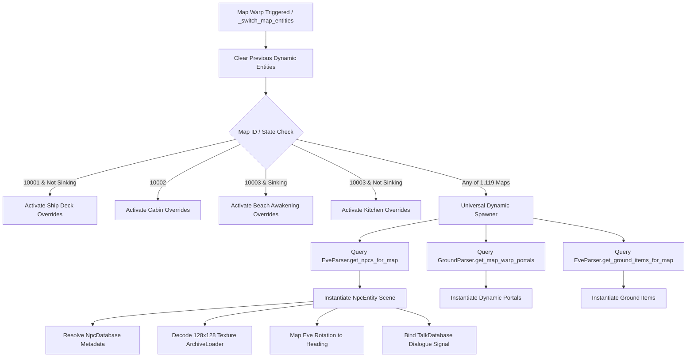

# Universal Dynamic Map, NPC, and Portal Spawner Specification

## Architectural Overview

The Universal Dynamic Map, NPC, and Portal Spawner engine provides automated, authoritative instantiation and lifecycle management of game entities across all 1,119 maps indexed in `Eve.emg`. It eliminates hardcoded map logic while preserving authentic cutscene overrides (such as the Ship Deck intro on Map 10001, Cabin tables on Map 10002, Kitchen bunks on Map 10003, and the Beach Awakening event post-sinking).

For any map in the game world, the spawner parses authentic binary definitions, resolves template metadata from `Npc.dat` / `all_npcs.json`, retrieves authentic 128x128 JMA/JMP sprite textures, configures 8-directional isometric headings and patrol paths, establishes dynamic warp portals, and hooks up interactive dialogue trees via `TalkDatabase`.

---

## Technical Specifications

### 1. Dynamic Spawner Method Signature

#### `_switch_map_entities(target_map_id: int) -> void`
- **Location:** `scripts/map/map_view.gd`
- **Purpose:** Coordinates entity lifecycle upon map transitions. Recycles existing dynamic NPCs, portals, and ground items; updates entity visibility; invokes either scenario overrides or the universal dynamic spawner.
- **Parameters:**
  - `target_map_id: int` - Destination map ID (e.g., 10001, 10002, 10003, 10005, 10008, 12001).
- **Behavior:**
  1. Iterates over `_dynamic_npcs`, calls `queue_free()` on valid instances, and clears the array.
  2. Invokes `_spawn_map_portals(target_map_id)` and `_spawn_ground_items(target_map_id)`.
  3. Toggles visibility for scenario entities (`_deck_entities`, `_cabin_entities`, `_kitchen_entities`, `_beach_entities`).
  4. Dispatches to `_spawn_dynamic_map_npcs(target_map_id)` when no static override applies.

#### `_spawn_dynamic_map_npcs(target_map_id: int) -> void`
- **Location:** `scripts/map/map_view.gd`
- **Purpose:** Instantiates authentic NPC entities dynamically from binary `Eve.emg` Category 0 definitions.
- **Parameters:**
  - `target_map_id: int` - Target map ID to query.
- **Processing Steps:**
  1. Queries `EveParser.get_npcs_for_map(target_map_id)`.
  2. Instantiates `res://scenes/world/npc.tscn` per spawn record.
  3. Resolves template details via `GameDatabase.npcs.get_npc(spawn.npc_id)` (`sprite_id`, `name`, `level`, `talk_image`).
  4. Maps Eve rotation (1..8) to isometric heading (0..7) via `IsometricMath.eve_rotation_to_heading(spawn.rotation)`.
  5. Decodes and assigns static 128x128 sprite texture via `ArchiveLoader.get_npc_texture(sprite_id, spawn.rotation)` or `ArchiveLoader.get_jma_frame_128`.
  6. Configures patrol path vectors and timing delays from `spawn.walksteps` and `spawn.walkstep_delays`.
  7. Pre-resolves dialogue records and choices via `TalkDatabase.resolve_talk_for_npc(spawn.npc_id, target_map_id)` and connects `npc_interacted` signal to `_on_npc_interacted`.
  8. Assigns `npc.map_data` to `map_renderer._map_data` for collision/walkability checks.
  9. Appends to `entities` Node2D container and tracks instance in `_dynamic_npcs`.

---

## Data Models and Helper Enhancements

### 1. `EveParser.NpcSpawnInfo` Coordinate Accessors
- **Path:** `scripts/map/eve_parser.gd`
- **Fields Added:**
  - `wx: int` - Getter/setter alias for `world_x`.
  - `wy: int` - Getter/setter alias for `world_y`.

### 2. `IsometricMath.eve_rotation_to_heading`
- **Path:** `scripts/map/isometric_math.gd`
- **Signature:** `static func eve_rotation_to_heading(rotation: int) -> int`
- **Transformation:**
  - Input: Eve clockwise rotation 1..8 (1: North, 2: North-East, 3: East, 4: South-East, 5: South, 6: South-West, 7: West, 8: North-West).
  - Output: 0-based counter-clockwise heading 0..7 (0: North, 7: North-East, 6: East, 5: South-East, 4: South, 3: South-West, 2: West, 1: North-West).
  - Formula: `(8 - ((rotation - 1) % 8)) % 8` if `rotation > 0` else `Heading.SOUTH`.

### 3. `NpcEntity` Interface Parity
- **Path:** `scripts/world/npc.gd`
- **Properties Added:**
  - `facing_direction: int` - Getter/setter alias wrapping `heading`.
  - `level: int` - NPC level (resolved from template record).
  - `texture: Texture2D` - Getter/setter wrapping sprite texture application.
  - `set_texture(tex: Texture2D) -> void` - Direct texture application helper maintaining 128x128 grounding offset.

### 4. `ArchiveLoader.get_npc_texture`
- **Path:** `scripts/core/archive_loader.gd`
- **Signature:** `func get_npc_texture(sprite_id: int, heading: int = 0) -> ImageTexture`
- **Package Resolution Matrix:**
  - `1..14`: Role archives (`002.jma`..`005.jma`).
  - `7000..7286`: Standard NPC archives (`007.jma`, `007_c01.jma`).
  - `1000..6999`: Monster and NPC archives (`001.jma`, `001_c01.jma`..`001_c04.jma`).
  - Fallback: Composites to transparent 128x128 canvas using anchor pivot coordinates.

---

## Verification and Test Coverage

The universal spawner engine is verified by three test suites:

| Test Suite | Path | Validation Scope |
|---|---|---|
| Universal Map & Spawner Suite | `tests/test_universal_map_and_npc_spawner.gd` | 10001 -> 10002 -> 10003 -> 10005 -> 10008 -> 12001 -> 10001 round-trip warp, dynamic NPC counts (5 on 10005, 41 on 10008, 3 on 12001), dialogue interaction, entity recycling. |
| Captain Dialogue & Sinking Suite | `scripts/tests/test_captain_dialogue_sinking_cutscene.gd` | Robinson dialogue sequence, camera trauma, stage transitions, map 10003 deserted island warp, Kelang NPC spawn. |
| Resizability & Layout Suite | `tests/test_game_resizable.gd` | 800x600 to 3840x2160 HUD anchoring, BattleView responsive layout, camera boundary clamping. |
